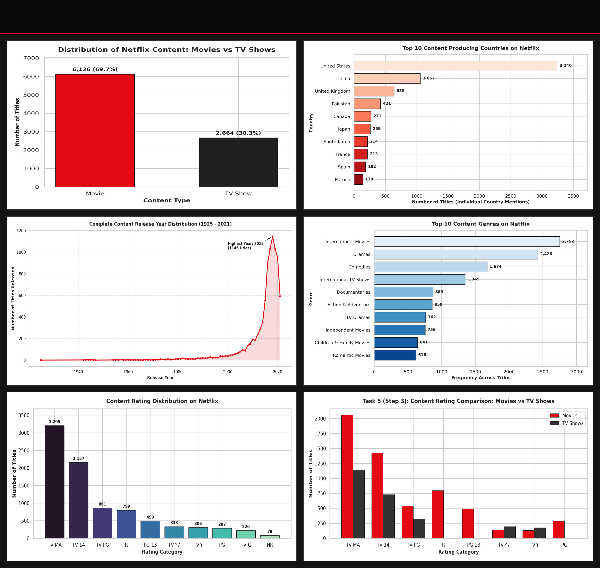
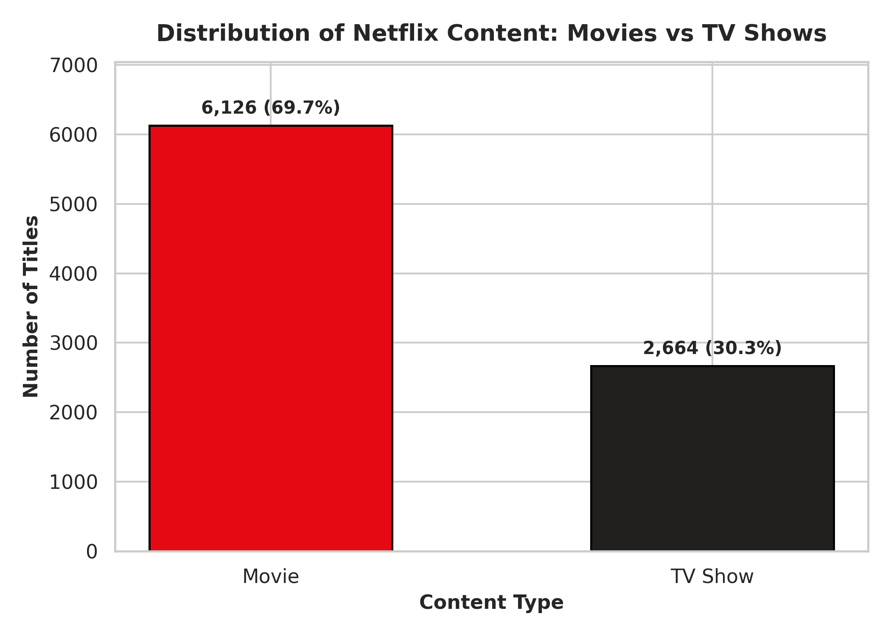
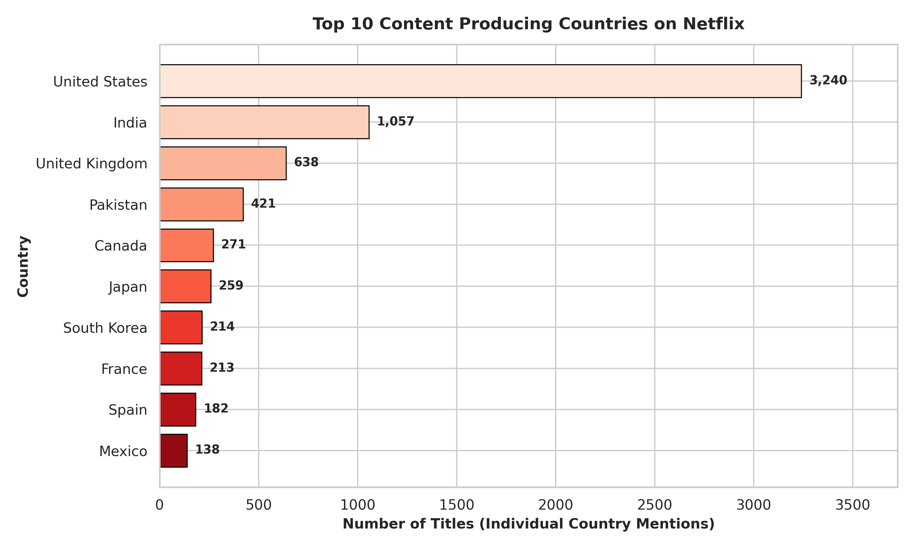
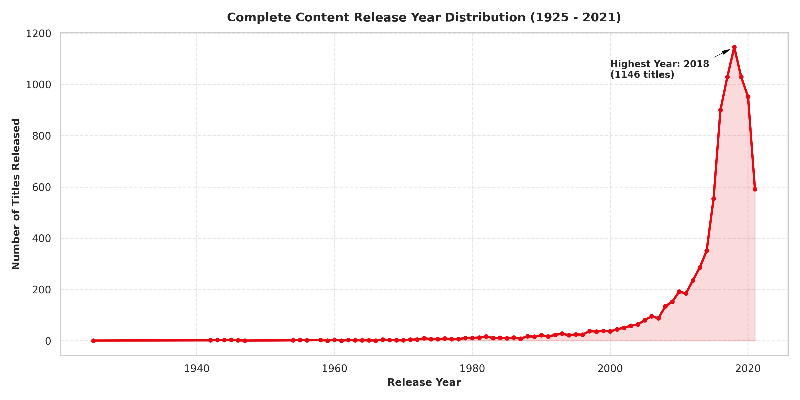
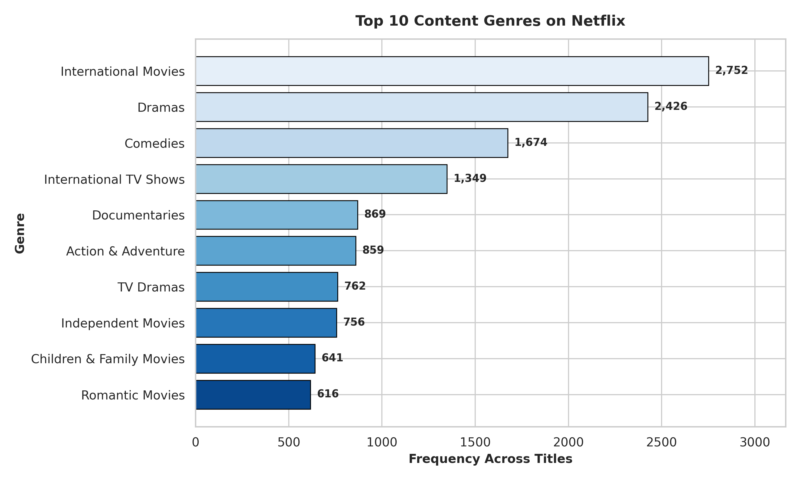
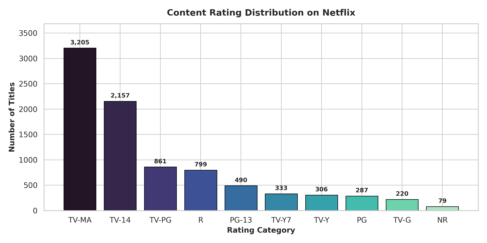
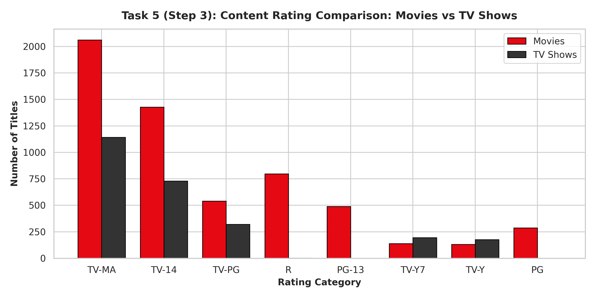

# 🎬 NETFLIX ANALYTICS — Data Analysis & Web Dashboard

[](https://python.org)
[](https://pandas.pydata.org)
[](https://www.chartjs.org)
[](https://developer.mozilla.org/en-US/docs/Web/HTML)
[](https://developer.mozilla.org/en-US/docs/Web/CSS)
[](https://github.com/sharmapriya18504-dotcom/netflix_project)

> A complete, professional Data Analytics internship project analyzing Netflix's catalog of 8,790 movies and TV shows using Python, Pandas, HTML5, CSS3, JavaScript, and interactive Chart.js visualizations.

---

## 🖥️ Dashboard Showcase Preview



---

## 📌 1. Project Introduction

This project was built for a **Data Analytics Internship Program (Auspify Technologies)**. It integrates:
1. **Python Data Engineering (`analysis.py`)**: Automated data cleaning, duplicate verification, datetime standardization, statistical aggregations, and high-resolution chart exports.
2. **Interactive Web Dashboard (`index.html`)**: A lightweight client-side analytics platform featuring a signature cinematic Netflix black-and-red design, 6 interactive Chart.js charts, live search & category filters, catalog modal popups, and an internship evaluation viva guide.

---

## 📊 2. Analytical Visualizations & Charts

All visualizations are generated directly from the 8,790 verified records in `data/Dataset.csv`.

### Comparison 1: Content Breakdown & Geographic Leadership

| **Content Type Distribution: Movies vs. TV Shows** | **Top 10 Content-Producing Countries** |
| :---: | :---: |
|  |  |
| **Observation:** Movies represent **6,126 titles (69.69%)**, outnumbering TV Shows (**2,664 titles, 30.31%**) by more than 2 to 1. | **Observation:** Multi-country co-productions were exploded. The United States leads with **3,240 titles**, followed by India with **1,057 titles**. |

---

### Comparison 2: Historical Production Timeline & Core Genres

| **Historical Release Year Trend (1925 – 2021)** | **Top 10 Most Common Content Genres** |
| :---: | :---: |
|  |  |
| **Observation:** Content releases expanded exponentially between 2015 and 2018, reaching an all-time catalog peak in **2018 with 1,146 titles**. | **Observation:** **International Movies (2,752)** and **Dramas (2,426)** are the leading genres, followed by Comedies (1,674). |

---

### Comparison 3: Content Ratings & Comparative Format Segmentation

| **Content Rating Distribution (Audience Targeting)** | **Comparative Ratings: Movies vs. TV Shows** |
| :---: | :---: |
|  |  |
| **Observation:** **TV-MA (3,205 titles, 36.46%)** and **TV-14 (2,157 titles, 24.54%)** make up over **61.0%** of all content. | **Observation:** Movies dominate mature film ratings R (797 vs 2) and PG-13 (490 vs 0), while TV Shows maintain balanced shares in TV-MA and TV-14. |

---

## 🎯 3. Core Analytical KPIs

| Metric | Verified Value | Analytical Significance |
| :--- | :--- | :--- |
| **Total Catalog Titles** | **8,790** | 100% verified catalog records from `Dataset.csv` |
| **Movies Count** | **6,126 (69.7%)** | Dominant content type on the platform |
| **TV Shows Count** | **2,664 (30.3%)** | Episodic content driving viewer retention |
| **Content Producing Countries** | **122 Countries** | Worldwide international catalog footprint |
| **Top Content Genre** | **International Movies (2,752)** | Highlights global localization strategy |
| **Historical Peak Release Year** | **2018 (1,146 Titles)** | Peak content acquisition and release period |

---

## 🎨 4. Netflix Cinematic Design System

- **Main Background**: `#141414` (Deep Cinematic Netflix Black)
- **Header & Navbar**: `#0B0B0B` (Dark Charcoal with Glassmorphism Blur)
- **Brand Accent**: `#E50914` (Signature Netflix Crimson Red)
- **Cards**: `#1C1C1C` with `#303030` subtle borders and red glow hover effects
- **Typography**:
  - **Bebas Neue**: Logo, badge emblems, and rank tags
  - **Outfit (700, 800, 900)**: Bold geometric headings, KPI numbers, and titles
  - **Inter (500, 600)**: Crisp body text with high contrast

---

## 🌟 5. Unique Web Features

1. **Cinematic Hero Spotlight Banner**: Features highlighted titles with prominent Netflix branding, metadata badges, and interactive details modal.
2. **Top 5 Global Spotlights Row**: Displays iconic global hits (*Squid Game*, *Stranger Things*, *The Crown*, *Sacred Games*, *Our Planet*) with rich poster thumbnails.
3. **Interactive Catalog Explorer**:
   - **Live Search**: Instant zero-lag filtering by title, director, country, or genre.
   - **Type Filter Pills**: Switch between `All Types`, `Movies Only`, and `TV Shows Only`.
   - **Dynamic Sorting**: Sort by newest, oldest, or alphabetical order.
   - **Smooth Pagination**: Clean navigation showing 12 titles per page across 733 pages.
4. **Netflix-Style Movie Detail Modal**: Frosted glass popup displaying director, country, release year, duration, rating, and clickable genre tags.
5. **CSV Export Button**: Download catalog data directly as a CSV file in browser.
6. **Internship Viva Mode**: Built-in guide covering project methodology and top evaluation questions with model answers.

---

## 📁 6. Project Structure

```text
Netflix_Data_Analysis_Internship/
│
├── data/
│   └── Dataset.csv               # Original raw Netflix dataset (preserved untouched)
│
├── results/
│   ├── cleaned_netflix.csv       # Cleaned dataset (8,790 records)
│   ├── business_insights.txt     # Factual business insights report
│   └── plots/                    # High-res static PNG charts & showcase
│       ├── dashboard_showcase.png    # 2x3 Dashboard collage preview
│       ├── content_type.png          # Content type breakdown
│       ├── top_countries.png         # Top 10 producing countries
│       ├── release_year.png          # Release year timeline
│       ├── top_genres.png            # Top 10 genres
│       ├── ratings.png               # Content rating distribution
│       └── ratings_by_type.png       # Comparative ratings (Movies vs TV Shows)
│
├── index.html                    # ⭐ Main Web Dashboard (HTML5)
│
├── style.css                     # ⭐ Custom Netflix Stylesheet
│
├── app.js                        # ⭐ Interactive Logic, Search, Modals & Chart.js
│
├── data.js                       # ⭐ Verified dataset export (8,790 records)
│
├── analysis.py                   # Automated Python analysis script
│
├── requirements.txt              # Python dependencies
│
├── .gitignore                    # Excludes virtual environments and cache
│
└── README.md                     # Documentation & evaluation guide
```

---

## 🚀 7. How to Run Locally

### Method 1: Direct Double-Click (Easiest & Fastest)
1. Navigate to the project directory:
   `c:\Users\Priya Sharma\Netflix_Data_Analysis_Internship`
2. Double-click **`index.html`**.
3. It will immediately open in your default browser (Chrome, Edge, Firefox, Brave) — **no installation or server needed!**

### Method 2: Python HTTP Server
```bash
# In the project root directory:
python -m http.server 8000
```
Open **`http://localhost:8000`** in your browser.

### Method 3: Run Python Analysis Script
```bash
python analysis.py
```
This regenerates `cleaned_netflix.csv`, all 6 plots in `results/plots/`, and `business_insights.txt`.

---

## 🌐 8. Deploying to Vercel

1. Log in to **[Vercel.com](https://vercel.com)** using your GitHub account.
2. Click **"Add New..." ➔ "Project"**.
3. Select this repository: **`netflix_project`**.
4. In Project Settings:
   - **Framework Preset**: *Other*
   - **Root Directory**: `./`
5. Click **"Deploy"**! In ~15 seconds, your platform will be live globally.

---

## 🎓 9. Internship Evaluation & Viva Guide

- **Q1: Why use `.explode()` on Country and Genre columns?**
  - *Answer:* Titles are frequently co-produced across multiple countries or belong to multiple genres. Splitting by comma and using `.explode()` counts each country and genre participation accurately rather than treating combinations as distinct entries.
- **Q2: Why convert 'Not Given' placeholders to NaN instead of dropping rows?**
  - *Answer:* 2,588 titles omitted director information. Using `dropna()` would delete nearly 30% of our dataset. Converting 'Not Given' to `np.nan` preserves content type, release year, genre, and ratings.
- **Q3: Why preserve titles with duplicate names and types?**
  - *Answer:* 4 pairs of titles share identical names and types (e.g., "15-Aug", "22-Jul"), but each has a distinct `show_id` and represents a distinct catalog entry. Full-row duplicates across all 10 columns were 0.

---

## 👩‍💻 Author & Acknowledgments

- **Intern**: Priya Sharma
- **Email**: sharmapriya18504@gmail.com
- **Repository**: [https://github.com/sharmapriya18504-dotcom/netflix_project](https://github.com/sharmapriya18504-dotcom/netflix_project)
- **Internship Program**: Auspify Technologies — Data Analysis Using Python
