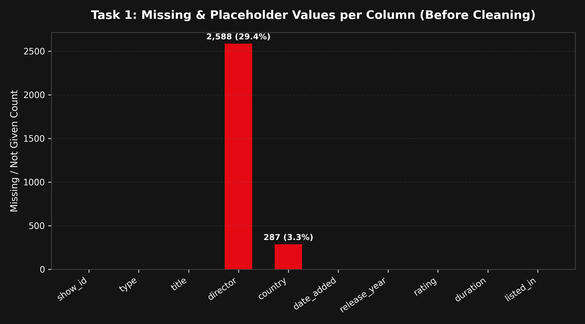
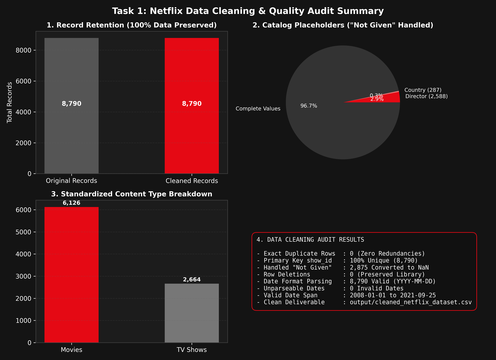

# Auspify Data Analysis Using Python Internship

Student Name: Priya Sharma  
Internship: Data Analysis Using Python  
Organization: Auspify Technologies  

---

## 1. About the Project

This project contains four practical data analysis tasks completed for the Auspify Technologies internship.

The goal is to analyze the Netflix dataset using Python. The project includes data cleaning, content type analysis, country-wise analysis, and yearly trend analysis.

Each task has its own Python code, output CSV files, and charts.

---

## 2. Tasks Completed

### Task 1: Netflix Data Cleaning & Preparation
- Loaded the raw Netflix dataset with 8,790 records.
- Checked for missing values and found 2,875 "Not Given" text placeholders.
- Replaced "Not Given" with standard NaN without deleting any valid rows.
- Verified that there are zero duplicate records.
- Cleaned extra spaces and standardized columns like Type, Rating, and Dates.
- Exported the cleaned dataset (`cleaned_netflix_dataset.csv`) and summary reports.

### Task 2: Content Type Analysis
- Analyzed the count of Movies and TV Shows on Netflix.
- Found that Movies make up 6,126 titles (69.69%) and TV Shows make up 2,664 titles (30.31%).
- Calculated that Movies outnumber TV Shows by a ratio of 2.3 : 1.
- Created bar charts and pie charts using Matplotlib.
- Exported summary tables and percentage reports.

### Task 3: Country-Wise Netflix Content Analysis
- Analyzed content availability across different countries.
- Handled multi-country listings by splitting comma-separated values.
- Excluded unavailable country records ("Not Given") to keep data accurate.
- Found that 85 distinct countries are represented in the catalogue.
- Identified the top countries: United States (3,240 titles), India (1,057 titles), and United Kingdom (638 titles).
- Compared Movies and TV Shows for each top country.

### Task 4: Trend Analysis by Release Year
- Analyzed how Netflix titles are distributed by original release year.
- Verified that content spans 97 years, from 1925 to 2021.
- Found the peak release year in the catalogue is 2018 with 1,146 titles.
- Identified that over 80% of titles were released between 2015 and 2021.
- Compared the growth trends of Movies and TV Shows over time.

---

## 3. Technologies Used

- **Python**: Main programming language for data analysis.
- **Pandas**: Used for loading data, cleaning, grouping, and calculating statistics.
- **NumPy**: Used for handling missing values (NaN).
- **Matplotlib**: Used for generating bar charts, pie charts, and trend line charts.

---

## 4. Project Structure

```text
Auspify_Data_Analysis_Internship/
│
├── data/
│   └── Dataset.csv
│
├── screenshots/
│   ├── Task_1/
│   ├── Task_2/
│   ├── Task_3/
│   └── Task_4/
│
├── Task_1_Data_Cleaning/
│   ├── data/
│   │   └── Dataset.csv
│   ├── output/
│   │   ├── cleaned_netflix_dataset.csv
│   │   ├── missing_values_report.csv
│   │   └── cleaning_summary.txt
│   ├── cleaning.py
│   ├── requirements.txt
│   └── README.md
│
├── Task_2_Content_Type_Analysis/
│   ├── output/
│   │   ├── content_type_summary.csv
│   │   ├── content_type_percentages.csv
│   │   ├── content_type_bar_chart.png
│   │   └── content_type_pie_chart.png
│   ├── analysis.py
│   ├── requirements.txt
│   └── README.md
│
├── Task_3_Country_Wise_Analysis/
│   ├── output/
│   │   ├── country_content_summary.csv
│   │   ├── top_10_countries.csv
│   │   ├── country_type_comparison.csv
│   │   ├── top_10_countries.png
│   │   └── country_type_breakdown.png
│   ├── country_analysis.py
│   ├── requirements.txt
│   └── README.md
│
└── Task_4_Release_Year_Trend_Analysis/
    ├── output/
    │   ├── yearly_content_summary.csv
    │   ├── top_release_years.csv
    │   ├── yearly_content_trend.png
    │   ├── top_release_years.png
    │   └── content_type_year_comparison.png
    ├── trend_analysis.py
    ├── requirements.txt
    └── README.md
```

---

## 5. Screenshots of Completed Tasks

### Task 1 – Netflix Data Cleaning & Preparation
- **Missing & Placeholder Values Analysis**:  
  

- **Data Cleaning & Quality Audit Summary**:  
  

### Task 2 – Content Type Analysis
- **Content Type Bar Chart**:  
  

- **Content Type Pie Chart**:  
  

### Task 3 – Country-Wise Netflix Content Analysis
- **Top 10 Countries by Content Volume**:  
  

- **Movies vs TV Shows by Country**:  
  

### Task 4 – Trend Analysis by Release Year
- **Yearly Content Distribution Trend**:  
  

- **Top 10 Release Years Bar Chart**:  
  

- **Movies vs TV Shows Historical Trajectory**:  
  

---

## 6. How to Run

### Step 1: Install Required Libraries
Open your terminal in the project folder and run:
```bash
pip install pandas numpy matplotlib
```

### Step 2: Run Task Scripts

To run Task 1 (Data Cleaning):
```bash
cd Task_1_Data_Cleaning
python cleaning.py
cd ..
```

To run Task 2 (Content Type Analysis):
```bash
cd Task_2_Content_Type_Analysis
python analysis.py
cd ..
```

To run Task 3 (Country-Wise Analysis):
```bash
cd Task_3_Country_Wise_Analysis
python country_analysis.py
cd ..
```

To run Task 4 (Release Year Trend Analysis):
```bash
cd Task_4_Release_Year_Trend_Analysis
python trend_analysis.py
cd ..
```

All charts and CSV outputs will be saved inside the `output/` folder of each task.

---

## 7. What I Learned

- How to inspect a real dataset using basic Pandas functions like `head()`, `info()`, and `describe()`.
- How to detect missing values when they are written as text like "Not Given".
- Why we should keep rows with missing values if other columns have useful data.
- How to check for duplicates and verify data accuracy.
- How to use Pandas functions like `value_counts()`, `groupby()`, `explode()`, and `unstack()`.
- How to create clear charts using Matplotlib and save them as PNG images.

---

## 8. Conclusion

During this internship at Auspify Technologies, I successfully completed all four data analysis tasks using Python and Pandas. 

This project gave me practical experience in the full data analysis process, from raw data cleaning to exploratory analysis, trend identification, and chart visualization. All results were created from actual dataset numbers without any fake data.
