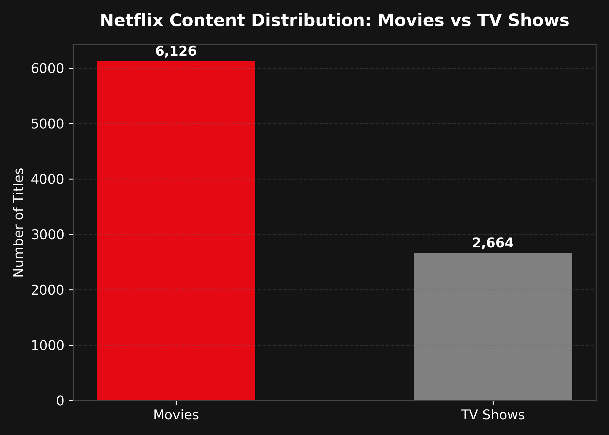
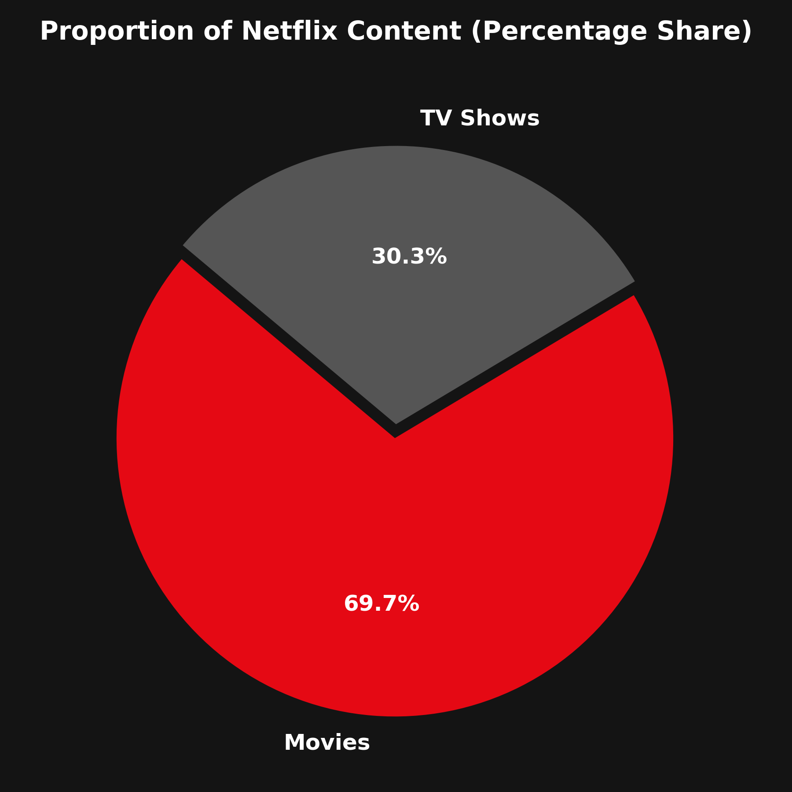
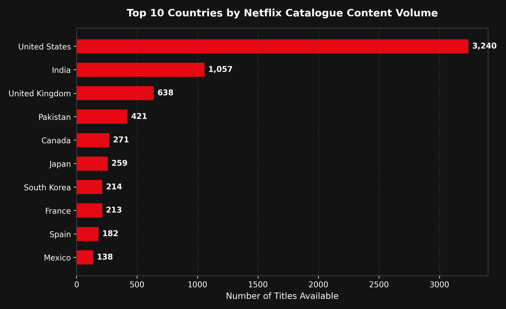
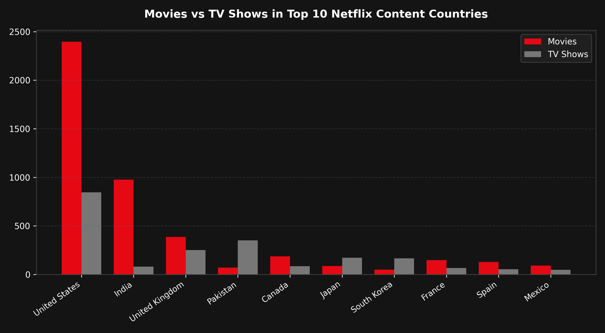
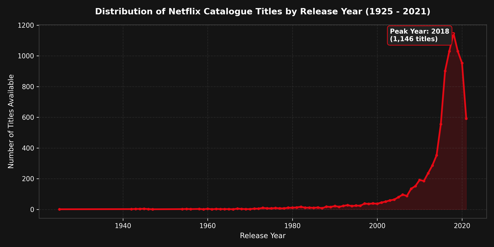
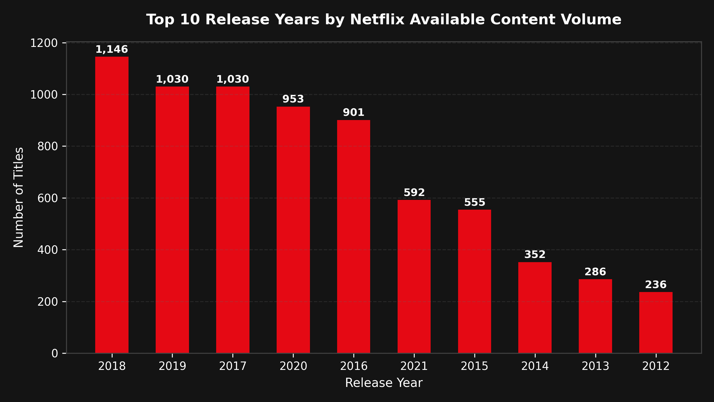
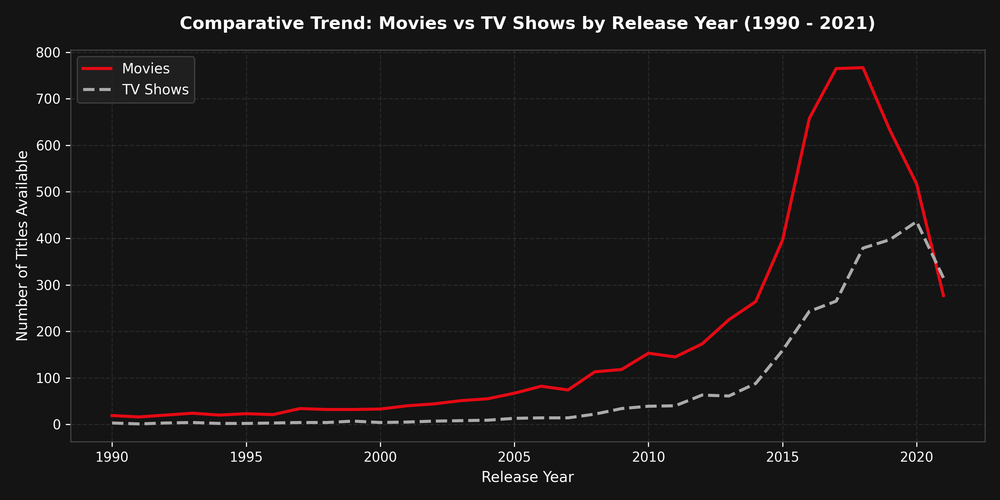

# Auspify Data Analysis Using Python Internship

Student Name: Priya Sharma  
Internship: Data Analysis Using Python  
Organization: Auspify Technologies  

---

## 1. About the Project

This project contains four practical data analysis tasks completed as part of the Auspify Technologies internship program. 

The goal of this internship is to analyze the Netflix dataset using Python and web technologies. The project covers data cleaning, content type analysis, country-wise content analysis, and yearly trend analysis.

Each task has its own Python code, output files, charts, and a web dashboard.

---

## 2. Tasks Completed

### Task 1: Netflix Data Cleaning & Preparation
- Loaded the raw Netflix dataset containing 8,790 records.
- Checked for missing values and identified 2,875 "Not Given" text placeholders.
- Replaced "Not Given" values with standard NaN without deleting valid rows.
- Verified that there are zero duplicate rows in the dataset.
- Cleaned extra spaces and standardized columns like Type, Rating, and Dates.
- Exported the cleaned dataset (`cleaned_netflix_dataset.csv`) and summary reports.

### Task 2: Content Type Analysis Dashboard
- Analyzed the distribution of Movies and TV Shows on Netflix.
- Found that Movies make up 6,126 titles (69.69%) and TV Shows make up 2,664 titles (30.31%).
- Calculated that Movies outnumber TV Shows by a ratio of 2.3 : 1.
- Created bar charts and pie charts using Matplotlib.
- Built an interactive web dashboard to show the results.

### Task 3: Country-Wise Netflix Content Analysis
- Analyzed content availability across different countries.
- Handled multi-country listings by splitting and exploding comma-separated values.
- Excluded unavailable country records ("Not Given") to keep data accurate.
- Found that 85 distinct countries are represented in the catalogue.
- Identified the top countries: United States (3,240 titles), India (1,057 titles), and United Kingdom (638 titles).
- Compared Movies and TV Shows for each top country.

### Task 4: Trend Analysis by Release Year
- Analyzed how Netflix catalogue titles are distributed by original release year.
- Verified that content spans 97 years, from 1925 to 2021.
- Found the peak release year in the catalogue is 2018 with 1,146 titles.
- Identified that over 80% of titles were released between 2015 and 2021.
- Compared the growth trends of Movies and TV Shows over time.

---

## 3. Technologies Used

- **Python**: Main programming language for data analysis.
- **Pandas**: Used for loading data, cleaning, grouping, and calculating statistics.
- **NumPy**: Used for handling missing values (NaN).
- **Matplotlib**: Used for generating bar charts, pie charts, and trend line charts.
- **HTML5**: Used for structuring the web dashboards.
- **CSS3**: Used for Netflix-inspired dark theme styling.
- **JavaScript**: Used for dynamic data loading and download buttons.
- **Chart.js**: Used for interactive charts on the web dashboards.

---

## 4. Project Structure

```text
Auspify_Data_Analysis_Internship/
│
├── data/
│   └── Dataset.csv
│
├── screenshots/
│   ├── Task_1/
│   ├── Task_2/
│   ├── Task_3/
│   └── Task_4/
│
├── Task_1_Data_Cleaning/
│   ├── data/
│   │   └── Dataset.csv
│   ├── output/
│   │   ├── cleaned_netflix_dataset.csv
│   │   ├── missing_values_report.csv
│   │   └── cleaning_summary.txt
│   ├── reports/
│   │   ├── cleaning_results.json
│   │   └── cleaning_results.js
│   ├── cleaning.py
│   ├── index.html
│   ├── style.css
│   ├── script.js
│   ├── requirements.txt
│   └── README.md
│
├── Task_2_Content_Type_Analysis/
│   ├── output/
│   │   ├── content_type_summary.csv
│   │   ├── content_type_percentages.csv
│   │   ├── content_type_bar_chart.png
│   │   └── content_type_pie_chart.png
│   ├── reports/
│   │   ├── analysis_results.json
│   │   └── analysis_results.js
│   ├── analysis.py
│   ├── index.html
│   ├── style.css
│   ├── script.js
│   ├── requirements.txt
│   └── README.md
│
├── Task_3_Country_Wise_Analysis/
│   ├── output/
│   │   ├── country_content_summary.csv
│   │   ├── top_10_countries.csv
│   │   ├── country_type_comparison.csv
│   │   ├── top_10_countries.png
│   │   └── country_type_breakdown.png
│   ├── reports/
│   │   ├── country_analysis_results.json
│   │   └── country_analysis_results.js
│   ├── country_analysis.py
│   ├── index.html
│   ├── style.css
│   ├── script.js
│   ├── requirements.txt
│   └── README.md
│
└── Task_4_Release_Year_Trend_Analysis/
    ├── output/
    │   ├── yearly_content_summary.csv
    │   ├── top_release_years.csv
    │   ├── yearly_content_trend.png
    │   ├── top_release_years.png
    │   └── content_type_year_comparison.png
    ├── reports/
    │   ├── trend_analysis_results.json
    │   └── trend_analysis_results.js
    ├── trend_analysis.py
    ├── index.html
    ├── style.css
    ├── script.js
    ├── requirements.txt
    └── README.md
```

---

## 5. Screenshots of Completed Tasks

### Task 1 – Netflix Data Cleaning & Preparation
- **Web Dashboard**: Open `Task_1_Data_Cleaning/index.html` in your browser.
- To add your dashboard screenshot: Take a screenshot (`Windows + Shift + S`) and save it as:
  `screenshots/Task_1/data_cleaning_dashboard.png`
- Markdown reference:
  ```markdown
  
  ```

### Task 2 – Content Type Analysis Dashboard
- **Content Type Bar Chart (Actual Python Matplotlib Output)**:  
  

- **Content Type Pie Chart (Actual Python Matplotlib Output)**:  
  

- **Web Dashboard Screenshot Instructions**: Open `Task_2_Content_Type_Analysis/index.html` in your browser and save your screenshot as:  
  `screenshots/Task_2/content_type_dashboard.png`

### Task 3 – Country-Wise Netflix Content Analysis
- **Top 10 Countries by Content Volume (Actual Python Matplotlib Output)**:  
  

- **Movies vs TV Shows by Country (Actual Python Matplotlib Output)**:  
  

- **Web Dashboard Screenshot Instructions**: Open `Task_3_Country_Wise_Analysis/index.html` in your browser and save your screenshot as:  
  `screenshots/Task_3/country_analysis_dashboard.png`

### Task 4 – Trend Analysis by Release Year
- **Yearly Content Distribution Trend (Actual Python Matplotlib Output)**:  
  

- **Top 10 Release Years Bar Chart (Actual Python Matplotlib Output)**:  
  

- **Movies vs TV Shows Historical Trajectory (Actual Python Matplotlib Output)**:  
  

- **Web Dashboard Screenshot Instructions**: Open `Task_4_Release_Year_Trend_Analysis/index.html` in your browser and save your screenshot as:  
  `screenshots/Task_4/release_year_dashboard.png`

---

## 6. How to Run

### Step 1: Install Required Libraries
Open your terminal in the project folder and run:
```bash
pip install pandas numpy matplotlib
```

### Step 2: Run Task Scripts

To run Task 1 (Data Cleaning):
```bash
cd Task_1_Data_Cleaning
python cleaning.py
cd ..
```

To run Task 2 (Content Type Analysis):
```bash
cd Task_2_Content_Type_Analysis
python analysis.py
cd ..
```

To run Task 3 (Country-Wise Analysis):
```bash
cd Task_3_Country_Wise_Analysis
python country_analysis.py
cd ..
```

To run Task 4 (Release Year Trend Analysis):
```bash
cd Task_4_Release_Year_Trend_Analysis
python trend_analysis.py
cd ..
```

### Step 3: Open the Web Dashboards
Each task folder has its own `index.html` file.

You can open any dashboard by:
1. Double-clicking `index.html` inside any task folder to view it directly in your web browser.
2. Or running a simple local server from the project root:
   ```bash
   python -m http.server 8000
   ```
   Then open `http://localhost:8000` in your browser and click on any task folder.

---

## 7. What I Learned

- How to inspect and understand a real dataset using `head()`, `info()`, and `describe()`.
- How to detect real missing information when it is hidden as text strings like "Not Given".
- Why we should not delete rows with missing data when other columns have useful information.
- How to check for duplicates and maintain data integrity.
- How to use Pandas functions like `value_counts()`, `groupby()`, `explode()`, and `unstack()`.
- How to create clean charts using Matplotlib and save them as images.
- How to build a simple web dashboard using HTML, CSS, and JavaScript to present data analysis results clearly.

---

## 8. Conclusion

During this internship at Auspify Technologies, I successfully completed all four data analysis tasks using Python and Pandas. 

The project helped me understand the complete data analysis workflow, starting from raw data cleaning to exploratory analysis, trend identification, and building interactive web dashboards. All statistics and charts were created from actual data without using any artificial values.
